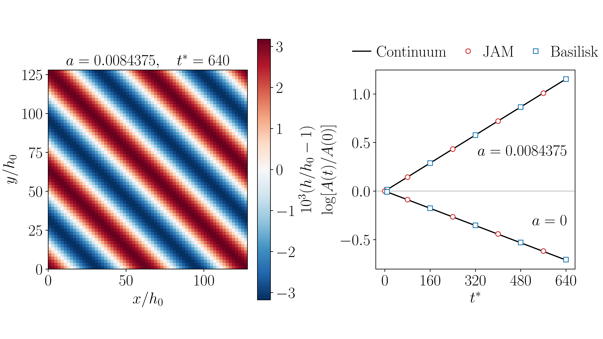
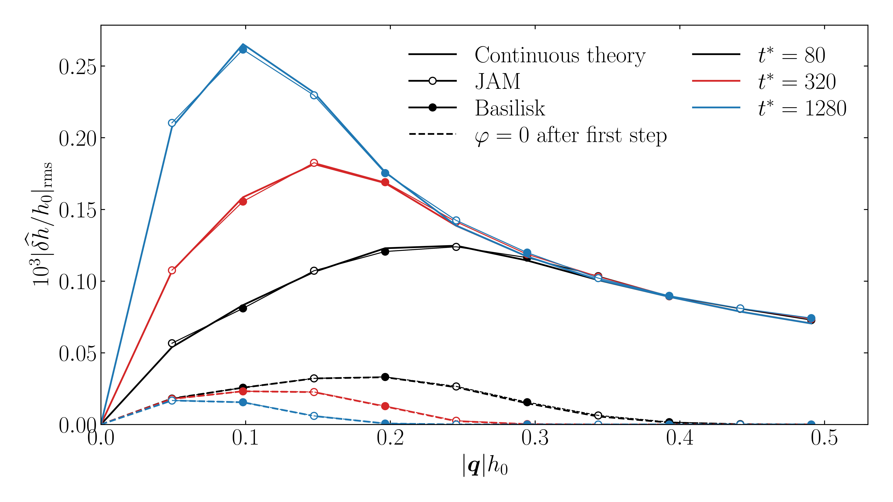
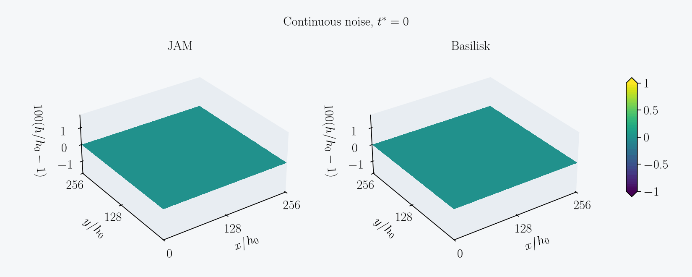

# 自由液膜破碎

本仓库用二维长波模型推进液–气–液体系中两界面之间的气层厚度。表面张力抹平起伏，范德华吸引可使长波扰动增长，热噪声则驱动稳定平膜的厚度涨落。算例覆盖接触前的近乎平膜阶段。

## 模型与时间推进

记无量纲厚度为 $`H=h/h_0`$，平膜对应 $`H=1`$。迁移率在平膜上取值，压力保留非线性的范德华项。无热噪声时，方程为

```math
\partial_{t^*}H=-\mathcal M P(H),\qquad
P(H)=-\tfrac12\nabla_*^2 H+a(H^{-3}-1).
```

其中 $`a`$ 为无量纲吸引系数，$`\nabla_*`$ 对无量纲膜面坐标求导。对模态 $`(m_x,m_y)`$，无量纲波数向量为 $`\boldsymbol q=2\pi(m_x/L_x^*,m_y/L_y^*)`$，其中 $`L_i^*=L_i/h_0`$，并记 $`q=|\boldsymbol q|`$。迁移率算子的 Fourier 乘子为

```math
M(q)=q^2\left(\frac{1}{12\mu_g}+\frac{1}{4\mu_\ell q}\right),\quad q>0,\qquad M(0)=0.
```

代码取无量纲黏度 $`\mu_g=0.02`$、$`\mu_\ell=1`$，表面张力系数为 1。将平膜线性化，连续理论给出模态率和振幅

```math
s^*(q)=M(q)\left(3a-\tfrac12q^2\right),\qquad
A(t^*)=A(0)\,e^{s^*(q)t^*}.
```

纯表面张力下，所有非零模态衰减。有吸引时，$`0<q<\sqrt{6a}`$ 的模态增长。正则模对照通过拟合 $`\log[A(t^*)/A(0)]`$ 的斜率得到数值模态率。

两套程序在周期等距网格上使用中心差分拉普拉斯算子，在 Fourier 空间作用迁移率，并按隐式中点推进

```math
H^{n+1}-H^n=-\Delta t^*\mathcal M_d P_d\!\left(\tfrac{H^{n+1}+H^n}{2}\right)
 + \frac{\sqrt{2\theta\Delta t^*\mathcal M_d}}{\Delta x^*}\,\xi^n.
```

$`P_d`$ 和 $`\mathcal M_d`$ 分别为离散压力和迁移率。设 $`q_{d,i}=2\sin(q_i\Delta x^*/2)/\Delta x^*`$，离散拉普拉斯的乘子为 $`-(q_{d,x}^2+q_{d,y}^2)`$，迁移率 $`M(q)`$ 外侧的 $`q^2`$ 也换成 $`q_{d,x}^2+q_{d,y}^2`$。平方根按 Fourier 乘子逐模态计算。$`\theta`$ 为无量纲噪声强度，$`\xi^n`$ 是该步的标准高斯网格场。持续加噪每步输入新的噪声场，仅首步加噪从第二步起将噪声项置零。

## 二维无涨落正则模

两组均采用 $`64\times64`$ 周期网格，取 $`L_x/h_0=L_y/h_0=128`$、$`\Delta t^*=8`$。初始扰动为斜向 $`(m_x,m_y)=(2,2)`$ 的余弦波，振幅 $`10^{-3}h_0`$，热噪声为零。

| 工况 | JAM 与 Basilisk 拟合的模态率 | 连续长波理论 |
| --- | --- | --- |
| 有吸引，$`a=0.0084375`$ | $`1.80083\times10^{-3}`$ | $`1.80299\times10^{-3}`$ |
| 无吸引，$`a=0`$ | $`-1.10159\times10^{-3}`$ | $`-1.10868\times10^{-3}`$ |

左图只展示有吸引时 Basilisk 在 $`t^*=640`$ 的厚度场。右图在同一坐标框内比较增长和衰减，黑线为连续理论。无吸引时，末态的模态振幅为初值的约 49.4%。



[正则模.ipynb](postprocess/正则模.ipynb) 用保存的厚度场和振幅历史重画合图。[合图 PDF](postprocess/figures/normal_mode_2d.pdf)

## 二维热涨落厚度场

[tcw.ipynb](postprocess/tcw.ipynb) 比较持续加噪与首步加噪的二维壳平均谱。对无吸引的稳定平膜，记非零 Fourier 模态的功率为 $`S(q,t^*)=\langle|\widehat{H-1}|^2\rangle`$。在边长为 $`L^*`$ 的正方形周期域，连续理论给出

```math
\begin{aligned}
S_{\rm on}(q,t^*)&=\frac{2\theta}{(L^*)^2q^2}\left[1-e^{2s^*(q)t^*}\right],\\
S_{\rm off}(q,t^*)&=S(q,t_0^*)\,e^{2s^*(q)(t^*-t_0^*)},\qquad t_0^*=\Delta t^*.
\end{aligned}
```

持续加噪从平膜起步，首步加噪以实测的首步功率谱为初值。图中对每个波数壳的功率取平均后开平方。



[TCW 谱 PDF](postprocess/figures/tcw_continuous.pdf)

动图取自 $512\times512$ 周期网格上种子 `61100` 的配对轨迹，左侧为 JAM，右侧为 Basilisk。两组显示相同的 $256h_0\times256h_0$ 区域，使用相同的视角、纵轴范围和色标。

### 持续加噪



### 仅首步加噪


## 代码入口

- [JAM 二维求解器](jam/jam_gas_film_2d.py) 的 `GasFilm2D.advance(h, white)` 推进一步。线性项在 Fourier 空间消元，有吸引时用解析雅可比修正非线性残差。
- [Basilisk 二维求解器](basilisk/gas_film_midpoint_2d.c) 用 `qcc` 编译，调用 [二维 FFT](basilisk/gas_fft_2d.h)，用定点迭代求解非线性中点压力。程序从标准输入读取初始厚度和逐步高斯场，从标准输出返回保存的厚度帧。
- [配对运行与谱统计](postprocess/run_tcw.py) 给两个求解器传入相同的初态和随机场，再计算 Fourier 壳平均谱。[后处理目录](postprocess/) 包含正则模与 TCW 的 Notebook 和示例数据，示例 TCW 数据来自 $`64^2`$ 网格和每种加噪方式 64 对轨迹。

## 复算

需要 NumPy、Matplotlib、Jupyter Python 内核和用于图中文字渲染的 LaTeX。使用 Basilisk `qcc` 编译二维中点程序。

```sh
python -m pip install -r requirements.txt
mkdir -p build
qcc -O3 -disable-dimensions -I"$PWD/basilisk" basilisk/gas_film_midpoint_2d.c -o build/gas_film_midpoint_2d -lm
python postprocess/run_tcw.py build/gas_film_midpoint_2d runs/tcw_512 --n 512 --replicas 30
```

$512^2$ 算例使用 $L_x/h_0=L_y/h_0=1024$，保留 $\Delta x/h_0=\Delta y/h_0=2$。在相同波数上限 $|\boldsymbol q|h_0\leq\pi/6$ 内，共有 84 个完整的非零 Fourier 壳。终点 $t^*=1280$，每条轨迹 160 步。两种协议各有 30 对轨迹，每对包含 JAM 和 Basilisk。

本机用 $512^2$ 网格实测每种协议 3 次、每次 32 步。按同一进程串行外推，持续加噪约 15 分钟，首步加噪约 8 分钟。外推覆盖推进和噪声输入准备，完整输出和谱统计另有少量开销。 [短测计时](postprocess/data/benchmark.json)
